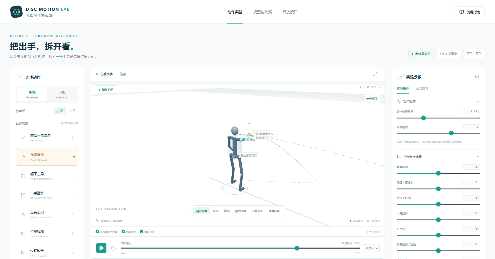
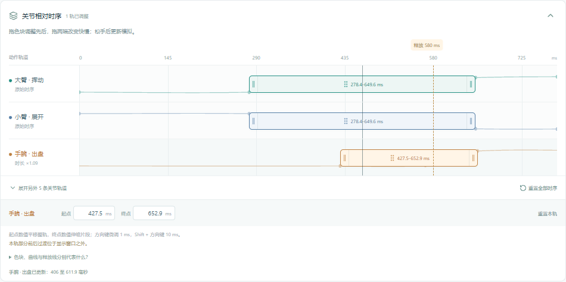

# 飞盘动作实验室 · Disc Motion Lab

用三维连杆拆解 175 g 极限飞盘的正反手平盘出手。从骨盆与胸廓的转动，到大臂挥动、肘部展开与手腕出盘，逐段看动作怎样传到飞盘。定格释放瞬间，还能继续观察盘速、自旋、盘面姿态和飞行轨迹。

面向 7v7 混合组极限飞盘的入门教学和动作讨论。场景提供正反手握盘与左右手镜像，方便把身前推盘、躯干主导、翻掌等预设与基础动作放在同一视角对比。

[下载 v1.3.1 HTML](https://github.com/345989/disc-motion-lab/releases/download/v1.3.1/disc-motion-lab-offline-v1.3.1.html) · [所有版本](https://github.com/345989/disc-motion-lab/releases)

## 开始实验

下载 `disc-motion-lab-offline-v1.3.1.html`，保存后用浏览器打开。界面、渲染和计算代码都在一个文件里，断网也能运行。WebGL 不可用时会自动切换到 Canvas 兼容视图。

1. 选择正手或反手，播放「基础平盘参考」。拖动播放条或跳到释放瞬间，切换俯视、侧视和握盘特写。
2. 试试「身前推盘」。默认开启的「叠加参考动作」会在同一场景显示灰色参考动作，方便比较关节路径、出手速度和自旋。切换「完整轨迹」，接着看离手后的飞行。
3. 将「手腕 · 出盘」色块往后拖，重看释放瞬间。观察同一动作中单独延后手腕，对盘速、自旋、方向和落点有什么影响。
4. 调整连杆尺寸、关节角、握点、盘面俯仰／滚转／偏航、释放相位或风速。可关闭空气对照真空抛物线，也可保存配置、轨迹 CSV 或完整模拟 JSON。

## 多轨动作时序

「关节相对时序」默认展示大臂挥动、小臂展开和手腕出盘。展开辅助轨道后，可继续调整大臂抬升、小臂轴向旋转、手腕屈伸、骨盆转动和胸廓转动。

拖动色块可平移整条角度曲线，拖动两端可缩短或拉长动作。释放线标出飞盘离手的时刻，点击可跳转。时序支持数值微调、单轨和全部复位，随配置 JSON 一起保存。

## 模型与开发

手持阶段用关键帧驱动三维关节链，按正反手各自的盘缘握点约束飞盘。离手时将盘心位置、姿态、线速度和角速度交给六自由度刚体模型。飞行中的升力、阻力和俯仰力矩采用 Hummel 附录收录的 Potts／Crowther 数据近似。内置动作曲线用于教学示意。公式、坐标、单位和研究来源见 [模型说明](source/MODEL.md)。

- [配置示例](sample-configs/)提供正反手参考、反手推盘和正手翻掌。
- 「运动指令」面板可编辑关节的基础关键帧。各轨时序写入可选 `timing` 字段，按 `globalPhase = sourcePhase * scale + shift` 应用。v1.1 和 v1.2 的配置可以直接导入。
- 浏览器控制台的 `window.DiscLab` 提供 `getConfig()`、`setConfig(config)`、`getSchema()`、`samplePose(phase)` 和 `simulate(config?)`。
- [`source/`](source/) 包含 v1.3 的 TypeScript 源码、构建脚本和物理测试。使用 Node.js 22.18+，在该目录运行 `npm install` 和 `npm run build`，即可在 `source/dist/` 重新生成单文件 HTML。运行 `npm test` 可检查物理模型。

## 版本记录

- [v1.3.1 · MIT 许可](https://github.com/345989/disc-motion-lab/releases/tag/v1.3.1) · [更新说明](docs/release-v1.3.1.md)
- [v1.3.0 · 开源发布](https://github.com/345989/disc-motion-lab/releases/tag/v1.3.0) · [更新说明](docs/release-v1.3.0.md)

- [v1.2.0 · 多轨动作时序](https://github.com/345989/disc-motion-lab/releases/tag/v1.2.0) · [更新说明](docs/release-v1.2.0.md)
- [v1.1.0 · 三维出盘实验台](https://github.com/345989/disc-motion-lab/releases/tag/v1.1.0) · [更新说明](docs/release-v1.1.0.md) · [原始验证记录](docs/v1.1-test-report.txt)

## 作者与许可

项目由 **345989** 制作，自 v1.3.1 起采用 [MIT 许可证](LICENSE)。欢迎使用、修改、分享，也可以用于商业用途。分发时请保留版权与许可声明。欢迎到 [Issues](https://github.com/345989/disc-motion-lab/issues) 交流你的实验和建议。

[第三方依赖许可](source/THIRD_PARTY_LICENSES.txt)随 HTML 一并打包。[构建说明](source/MODEL.md#开发与再构建)列出打包依赖的源码。
